# ParadigmShift

A clean, film-editor style app for designing and running **fMRI paradigms** — written in **Rust**
(egui), shipped as a **single standalone executable** for Windows, macOS and Linux.

Build your run like a video edit: drag blocks onto a timeline, trim them to whole TRs, drop in pictures, preview
exactly what the participant will see, then press **Run in scanner**. The app waits for the
**NordicNeuroLab SyncBox** trigger and records **NNL ResponseGrip** presses and picture ratings into BIDS-style
`events.tsv` files.


## Download

Get the file for your computer from the **[latest release](../../releases/latest)** – nothing to install:

| Computer | File | How to start |
|---|---|---|
| Windows 10/11 (64-bit) | `ParadigmShift-windows-x64.exe` | Double-click. SmartScreen may warn about an unknown publisher: *More info → Run anyway*. |
| macOS 11+ (Apple Silicon and Intel) | `ParadigmShift-macos-universal.zip` | Unzip and move *ParadigmShift.app* to *Applications*. The app is not notarised: the first time, right-click → *Open*. |
| Linux x86-64 | `ParadigmShift-linux-x86_64.tar.gz` | `tar xzf ParadigmShift-linux-x86_64.tar.gz && ./ParadigmShift-linux-x86_64/paradigmshift` |

The example paradigms (with their pictures) are built into the executable: **File → Open example**.
You can also pass a file on the command line: `paradigmshift my_task.paradigm.json`.

## Paradigm modules

Start from a classic task with **▦ Templates** (Ctrl+T), set the numbers, and get a complete, editable
timeline.

| Module | Default design | What is logged |
|---|---|---|
| **Emotion & reward** | | |
| Hariri face matching (Hariri 2002) | S F S F … S blocks, 6 matching trials × 5 s each; angry/fearful faces vs. shapes · 4:48 min | left/right, RT, correct |
| Emotion regulation (Ochsner 2002/04) | cue LOOK/DECREASE (opt. INCREASE) → picture 7 s → rating → jittered relax | rating, RT |
| Monetary incentive delay (Knutson 2000/01) | cue (win/lose/nothing) → anticipation 2–2.5 s → target 0.3 s → feedback → ITI; 15 trials per condition | hit/miss, RT, feedback shown |
| **Cognitive control** | | |
| Go / No-Go | 160 letters, 25 % No-Go (X), never two No-Go in a row | hit, miss, false alarm, correct rejection |
| Stroop | colour words in ink, 50 % incongruent (opt. neutral XXXX), 4 colours → 4 grip buttons, jittered ITI | correct/incorrect, RT per condition |
| Eriksen flanker | arrows, 50 % incongruent (opt. neutral), left/right grip, jittered ITI | correct/incorrect, RT per condition |
| **Working memory** | | |
| N-back | blocks of 0-back and 2-back (any levels, e.g. "0, 1, 2"), 15 letters, 33 % targets, cue + rest | hit, miss, false alarm, correct rejection |
| **Localizers & rest** | | |
| Motor localizer | finger tapping LEFT / RIGHT (opt. BOTH) 20 s vs. rest 20 s, 5 cycles | grip presses (all logged, counted live) |
| Visual checkerboard | 8 Hz flickering radial checkerboard 20 s vs. grey 20 s, red fixation dot | – |
| Resting state | instruction, then 8 min fixation (eyes open) or empty screen | – |

These rely on block types that you can also use on their own in any paradigm:

* **Matching trial** – three pictures (target on top, two choices below), the correct side and which grip
  buttons mean left and right. A frame marks the picture the participant chose (colour adjustable).
* **Go / No-Go trial** – a letter or picture that is visible for a set time, followed by a fixation symbol. No-Go
  trials are shown in red on the timeline.
* **Choice trial** – a word, symbol or picture in any colour, plus the correct button, *any* button (hit) or
  *no press* (withhold). Used by Stroop, flanker, N-back and the MID target.
* **Feedback** – shows one text if the previous trial was done right and another if not (MID).
* **Flickering image** – any image block can alternate with a second picture at a set rate (checkerboard).

**Stimuli:** licensed sets such as NimStim, KDEF, IAPS or OASIS can't be redistributed, so the templates
generate *placeholder* stimuli: schematic angry/fearful faces, geometric shapes, abstract neutral/negative
scenes, MID cues and checkerboards. For real studies, point the template at your own folders: the Hariri face
folder is sorted into angry and fearful faces by file name (`angry`/`fear`, NimStim `_AN_`/`_FE_`, KDEF
`AN`/`AF`); the emotion-regulation template takes one folder of neutral and one of negative pictures. The
defaults follow the published protocols, but check them against the protocol you are replicating.

## How it works – at a glance

| Area | What you do there |
|---|---|
| **Blocks** (left) | Drag *Fixation, Image, Rating, Instruction, Pause, …* onto the timeline – or double-click to append. An *Image* block can show a text underneath the picture (inspector → *Text under the picture*, with its own size and colour). |
| **Task blocks** (left) | Stroop/flanker/N-back trials and whole MID, emotion-regulation, N-back, Hariri, tapping, checkerboard and resting-state sequences – drag them onto the timeline like blocks. |
| **Pictures** (left) | Import pictures or drop files/folders on the window; drag one or many onto the timeline (each becomes an image block) – or drag a picture straight onto a picture field in the inspector, e.g. the top/left/right faces of a matching trial. |
| **Tool strip** (far left) | Always visible, like the tool strip of an image or video editor. *Blocks*, *Task blocks* and *Pictures* are independent panels: the small **×** in a panel's title minimises it into the strip, a click on its icon in the strip (or Ctrl+1 / 2 / 3, *View* menu) brings it back. Drag the gap between two panels to give one more room. With all three minimised the preview gets the whole width. The layout is remembered. |
| **Participant view** (centre) | Shows the screen at the playhead. ▶ / Space plays a preview of the run. |
| **Inspector** (right) | Edit the selected block(s). With nothing selected: TR, dummy scans, background, run summary. |
| **Timeline** (bottom) | Ruler in time *and* volumes. Click a block and the playhead jumps to it, so the participant view shows it. Grab the playhead's head (or click into the ruler) and drag to scrub through the run – it snaps to block edges, **Alt** = free. Drag blocks to move – if they don't fit into the gap where you hold them, a blue **insert** marker shows the nearest block boundary: release, and they are inserted there seamlessly (the blocks in between make room, the place they came from closes up, everything after both places keeps its timing; also for a Shift+click range of blocks, one Ctrl+Z undoes it). Drag edges to trim, everything snaps to the TR grid and to block edges (hold **Alt** to place freely). Right-click for more (duplicate, repeat ×N, split at playhead, close gaps…). |
| **✦ Quick design** | Builds a whole block design (ON/OFF, alternating or randomised) or an event-related design with jittered ITIs and optional ratings. |
| **⚙ Hardware** | Configure and *live-test* the SyncBox and grips (lamps light up, measured TR is shown, built-in scanner simulator). |
| **Run in scanner** | Participant ID, session, run, screen → full-screen presentation that waits for the trigger. |

**Selecting blocks:** click a block, then **Shift+click** another one – everything in between is selected (e.g. to
delete a whole stretch with **Del**; **Shift+Del** also closes the gap). **Ctrl+click** adds or removes single blocks,
dragging over empty track space draws a selection frame.

**Editing many blocks at once:** select several blocks of the same type (right-click → *Select all … blocks*,
**Edit → Select…**, or *Edit all … blocks together* in the inspector). Every setting then applies to all of them;
settings where they differ are marked **≠**. **Edit → Find and replace** (Ctrl+H) changes words in all texts at once.
One Ctrl+Z undoes each change. F1 lists the keyboard shortcuts.

**Unpleasant pictures:** *Options → Blur picture previews* (Ctrl+Shift+B) blurs every picture in the editor; a
separate preference blurs the control-room mirror. The participant's screen always shows the real pictures.

## During a run: control room & participant screen

**Run in scanner** turns the main window into the **control room** and opens the **participant screen**
(full screen on the chosen monitor, usually the projector):

* The participant only ever sees the paradigm. Before the start – including the **dummy scans** – they see a
  fixation cross, an empty screen or a text of your choice; after the run an end text.
* The control room shows a live mirror of the participant screen – exactly the same picture, in the same
  aspect ratio as the participant's window; the status (waiting → dummy scans *n / N* →
  running → finished); elapsed/remaining time, volume and trigger counts and the measured TR; a progress strip of
  the whole run; the current and next block; a live list of answers (RT, correct/incorrect, hit/miss/false alarm,
  ratings) and a running performance summary per condition; and warnings when the participant stops answering,
  when no trigger arrives, or when another app has the keyboard focus (SyncBox keys would be lost).
* Every section can be **folded** (click its title or use **☰ Sections**); the folding is remembered.
* Everything on the participant screen – pictures, texts, rating scales – scales with the window. Texts are
  sized relative to the screen height and shrink further if they would not fit, so nothing runs off the
  screen, even in a small or portrait window.
* Aborting takes two clicks or two presses of Esc (configurable). After an abort the clock stops, the part of the
  run that never happened is hatched, and the participant sees an empty screen.

| | |
|---|---|
| 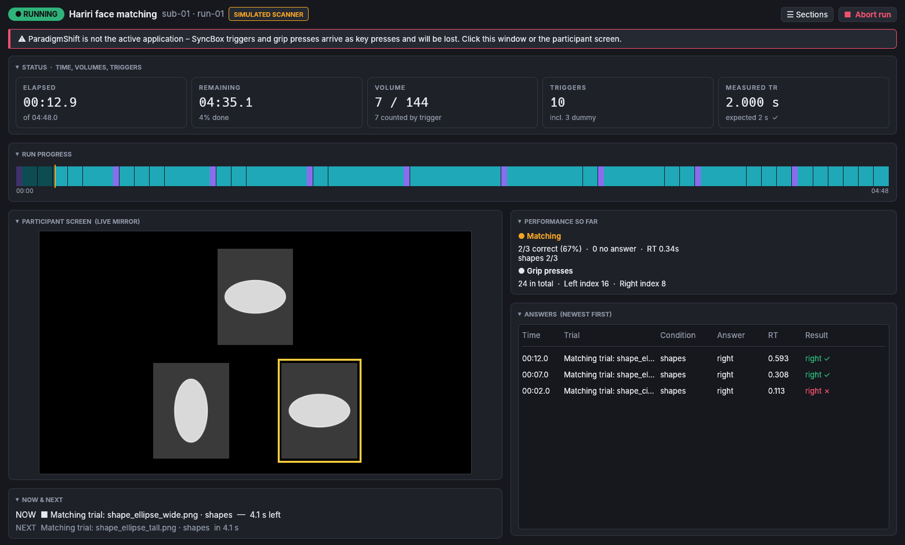 Control room during a (simulated) Hariri run | 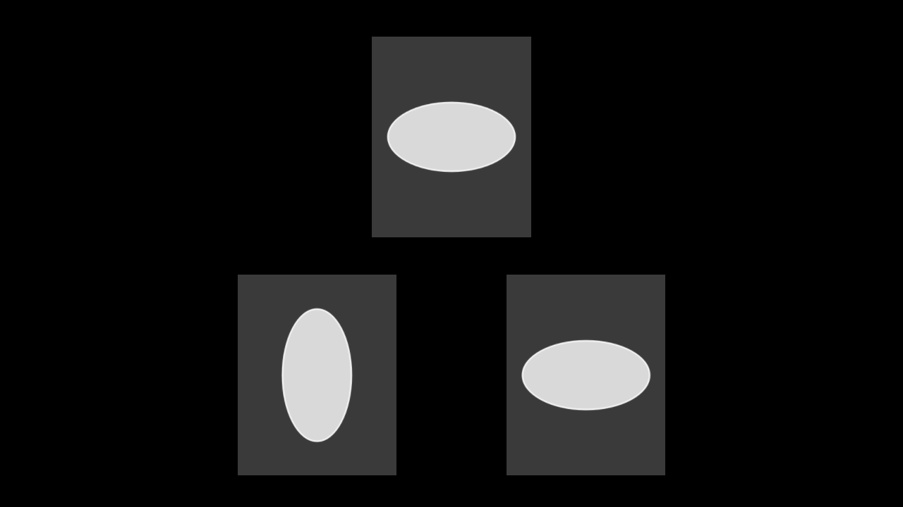 …and what the participant sees: the chosen face is framed |

## Scanner hardware (NNL)

* **SyncBox** – *USB keyboard mode* (default): the trigger arrives as a key, default `s`.
  *Serial mode* follows **NordicNeuroLab's own serial protocol** (from NNL's
  [py_syncbox](https://github.com/nordicneurolab/py_syncbox)): 57600 baud, trigger `s`, grips `a`–`d`.
  * **Auto-detect** sends NNL's computer-mode command to every serial port. The SyncBox answers it, so it is
    found without the scanner running; port, baud rate, trigger `s` and grip keys `a`–`d` are set. If no box
    answers, the app listens for a device that sends on its own.
  * With **Control the SyncBox** (on by default), each run switches the SyncBox to computer mode and configures it
    with the paradigm's TR and number of volumes (+ dummy scans + margin), then starts it in synchronisation mode.
    After the run the box is stopped and returned to manual mode. *Simulate scanner* then uses the SyncBox's own
    simulation, which tests the real cable path.
  * Errors say what to do: port not found, port in use (e.g. by NNL software), Linux `dialout` permission,
    and "the SyncBox did not confirm …".
* **ResponseGrips** – four named buttons with NNL's keys `a` (left thumb), `b` (left index), `c` (right index),
  `d` (right thumb). Rename, add, or re-learn keys in the Hardware dialog.
* **Rating scales** – *cursor* (move ◀ ▶, confirm ✓; the default) or *direct* (each grip button = one value).
  The buttons can be chosen freely for each rating block in the inspector (*Buttons*: ◀ / ▶ / ✓, or one button
  per value) – also for many selected ratings at once. The Hardware dialog only sets the defaults.
* **Simulate scanner** – test any paradigm on a laptop; triggers are generated at the TR.

> **Driver for serial mode:** the SyncBox's USB connection uses an **FTDI** chip. To use it in *serial mode* the
> computer needs FTDI's **VCP driver** (Virtual COM Port) – otherwise the SyncBox does not show up as a serial/COM
> port at all. NNL's own software installs this driver; on a computer without it, download it from
> [ftdichip.com → Drivers → VCP Drivers](https://ftdichip.com/drivers/vcp-drivers/) (Windows and macOS; Linux has the
> driver built into the kernel). **Alternatively, use USB keyboard mode**, which needs no driver at all. The
> Hardware dialog shows the same note with a download link.

## Output

For each run (in the chosen folder):

* `sub-01_task-<name>_run-01_events.tsv` – BIDS-style: `onset`, `duration`, `trial_type` (= condition),
  `stim_file`, `response`, `response_time`, `rating`, `correct`, `outcome` (hit, miss, false_alarm,
  correct_rejection, correct, incorrect) and `planned_onset` for timing checks.
* `sub-01_task-<name>_run-01_buttons.tsv` – **every** grip/key press of the whole run as a separate backup, written
  and flushed to disk the moment the button is pressed (survives a crash or an abort): `time`, `time_since_open`,
  `volume`, `wall_clock`, `key`, `button`, and the `block` on screen with its `block_kind` and `condition`.
* `sub-01_task-<name>_run-01_log.tsv` – every trigger, button press and stimulus onset with its time.
* `sub-01_task-<name>_run-01_paradigm.json` – a copy of the paradigm that was run (can be switched off).

Aborted runs get `_ABORTED` in the file names. Onsets are relative to the first trigger after the dummy scans.
**Export onsets** writes the planned design as `events.tsv` plus FSL 3-column files per condition.

> **Timing note:** the run clock runs on its own thread with 1 ms resolution – independently of which window has
> the focus or is being redrawn. Onsets are logged when a stimulus becomes due; the participant screen shows it at
> its next display frame. In serial mode, triggers and grip presses are time-stamped by a dedicated thread the
> moment they arrive; in USB-keyboard mode they are time-stamped when the window receives the key (within about one
> frame). For publication-grade timing, verify with a photodiode.

Paradigms are saved as `*.paradigm.json` (picture paths stored relative to the file).

## Screenshots

| | |
|---|---|
| 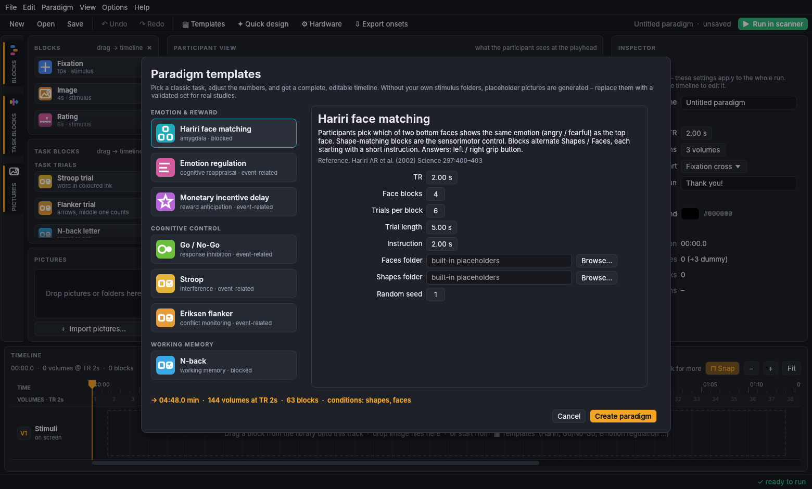 Templates: Hariri | 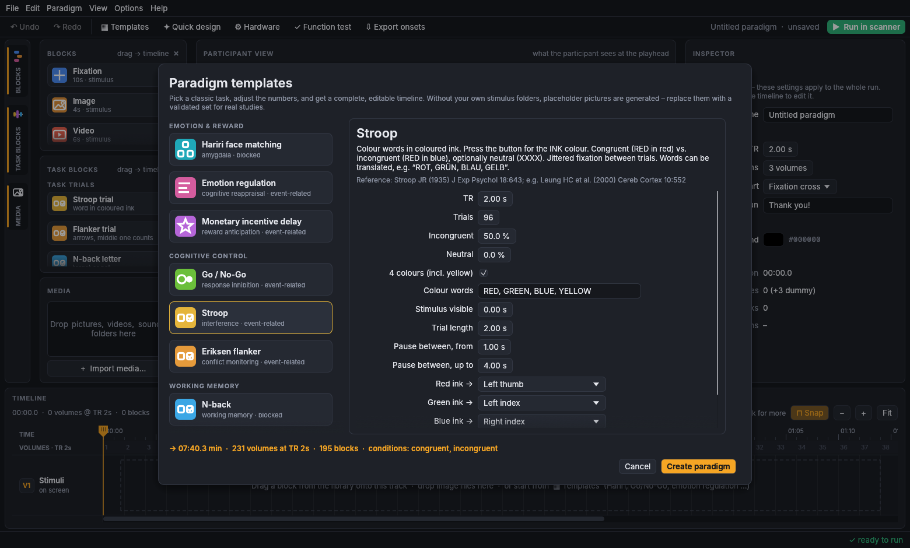 Templates: Stroop |
| 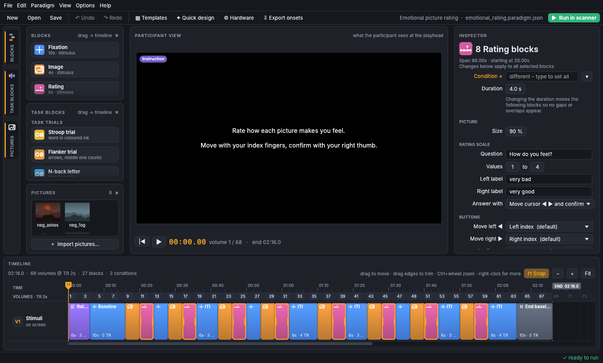 All 8 rating blocks edited together (≠ = different values) | 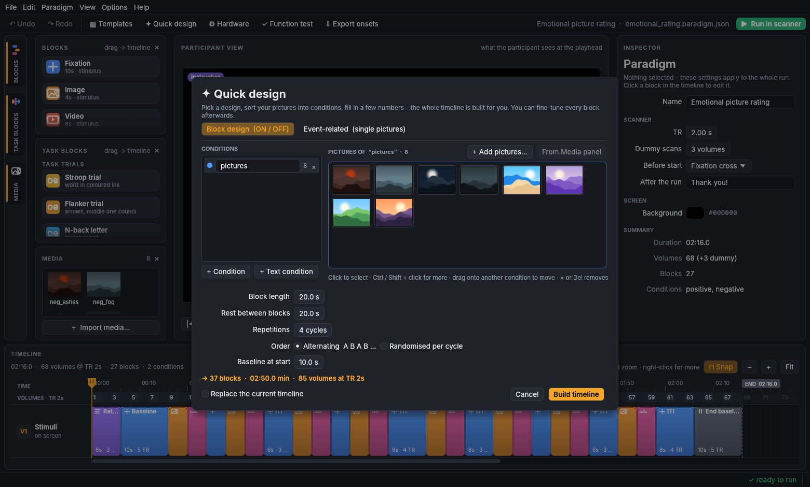 Quick design wizard |
| 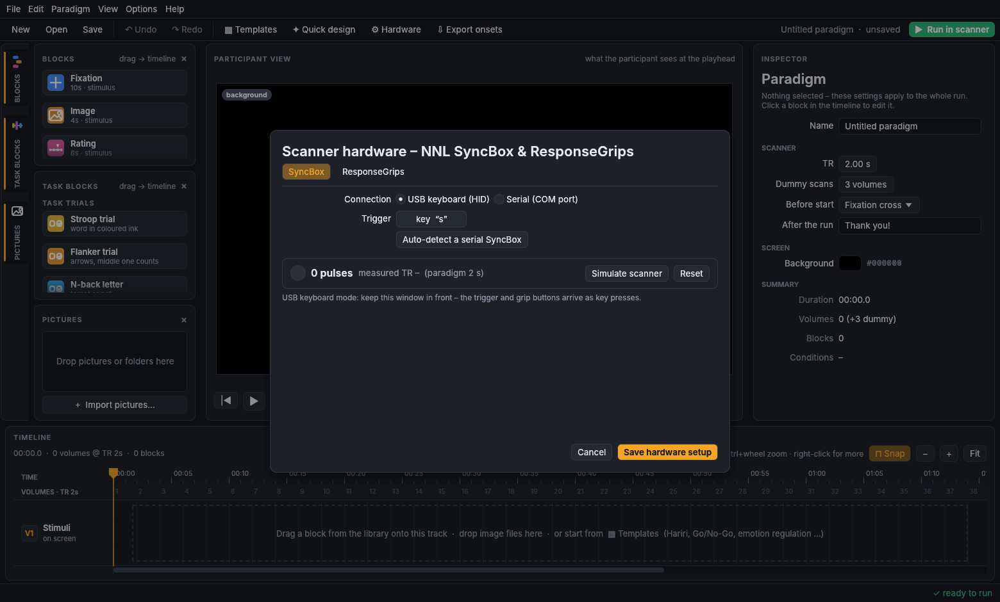 SyncBox setup with live trigger monitor | 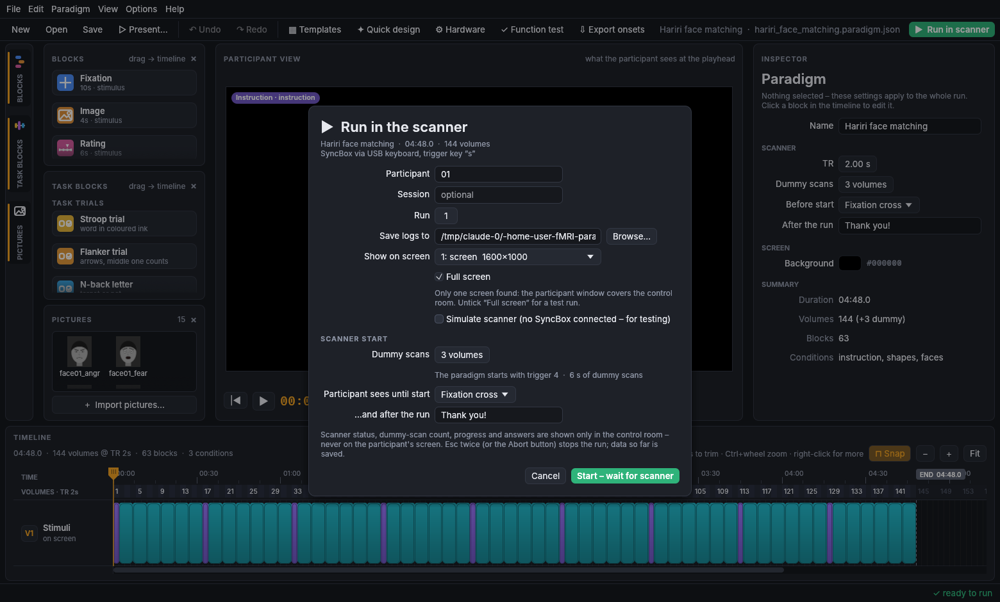 Run setup |
| 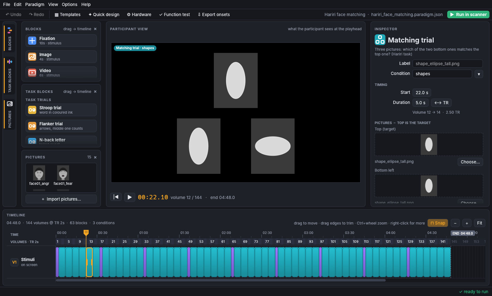 Hariri in the editor | 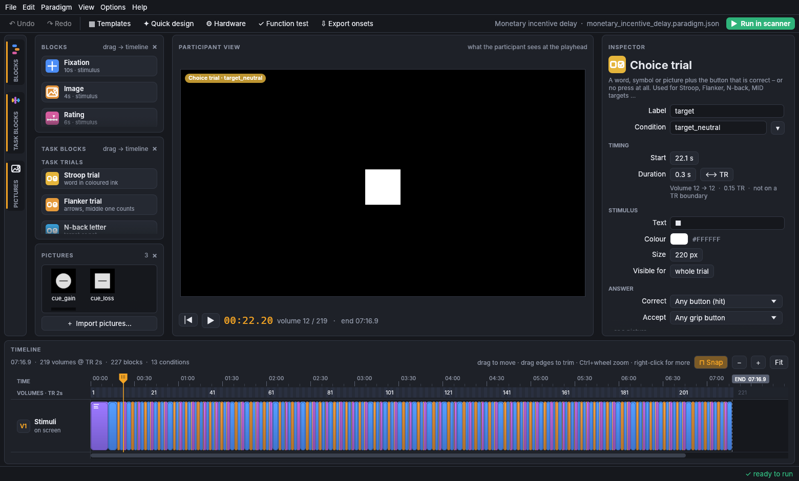 MID in the editor |
| 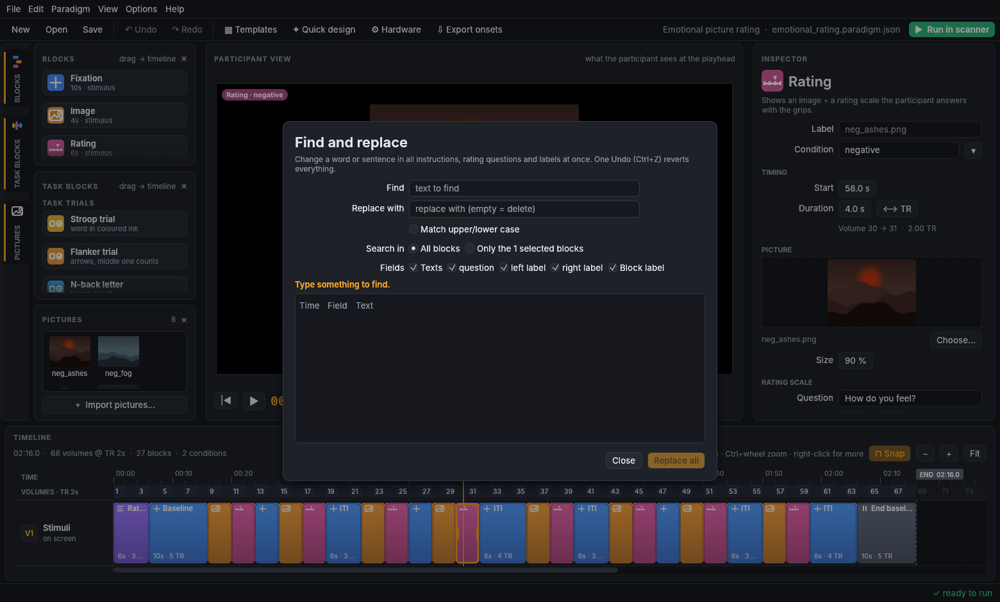 Find and replace in all texts | 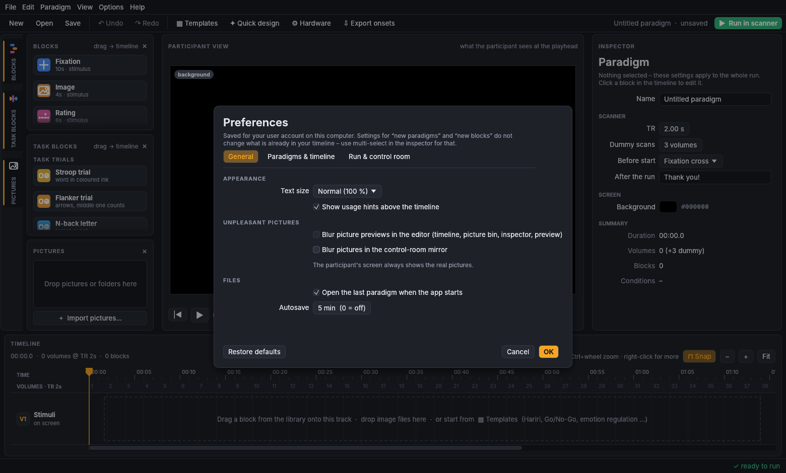 Preferences |
| 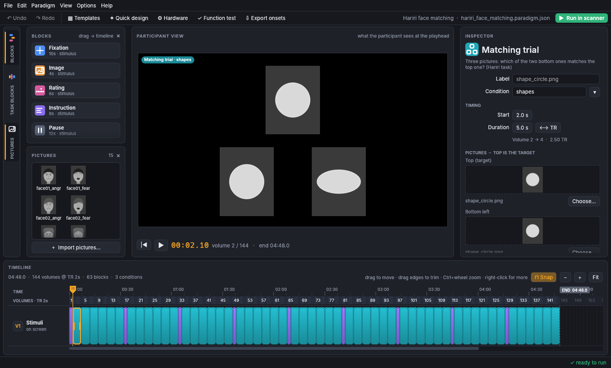 *Task blocks* minimised into the tool strip | 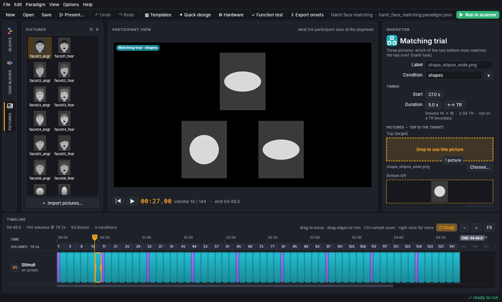 Dragging a face from *Pictures* onto the matching trial's top picture |
| 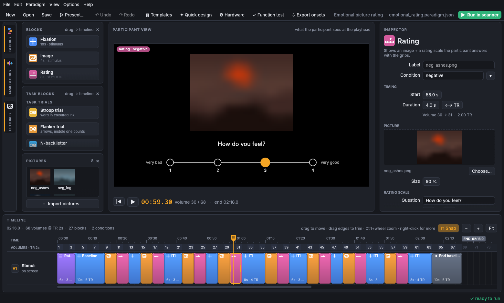 Blurred previews | |

The screenshots are generated by the app itself, e.g.
`paradigmshift --screenshot out.png --scene editor` (scenes: `editor`, `templates`, `bulk`, `quick`,
`hardware`, `run_dialog`, `control`, `participant`, `find`, `prefs`, `hariri`, `mid`, `blur`, `panels`,
`control_small`, `participant_small`). For the run scenes, `PARADIGMSHIFT_DEMO_SIZE=WxH`,
`PARADIGMSHIFT_DEMO_EXAMPLE=<example>` and `PARADIGMSHIFT_DEMO_TIME=<seconds>` set the participant window size,
the example and the moment of the screenshot.

## Building from source

Install Rust (<https://rustup.rs>), then:

```bash
cargo run --release                     # start the editor
cargo run --release -- examples/emotional_rating.paradigm.json
cargo test                              # unit tests (model, templates, runner, SyncBox protocol)
```

On Linux the build needs no extra libraries; at runtime the usual desktop libraries (X11 or Wayland, OpenGL,
`libxkbcommon`) are loaded.

The release workflow (`.github/workflows/release.yml`) builds the Windows `.exe`, a universal macOS `.app` and the
Linux binary on every push to `main` or a `v*` tag, and publishes them as a GitHub Release.

Code layout (`src/`): `model.rs` (paradigm, blocks, generators – no GUI), `templates.rs` (the ten paradigm
modules), `presets.rs` (task blocks), `placeholders.rs` (generated stimuli), `hardware.rs` (SyncBox/grips input,
NNL serial protocol, auto-detect), `runner.rs` (run clock, scoring, logging), `stimulus.rs` (shared renderer),
`timeline.rs`, `panels.rs` (library, picture bin, inspector), `dialogs.rs`, `controlroom.rs`, `app.rs` (main window),
`prefs.rs`, `document.rs` (undo/redo).

Bundled fonts: Inter (SIL Open Font License) and DejaVu Sans (Bitstream Vera license), see `assets/fonts/`.
