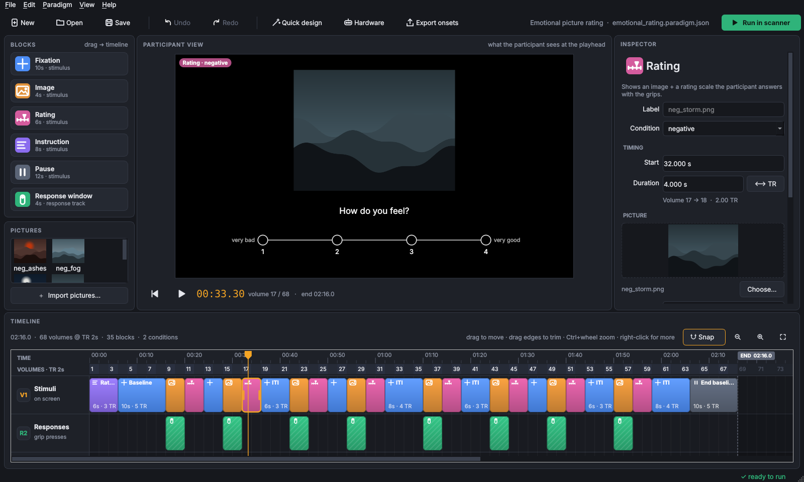
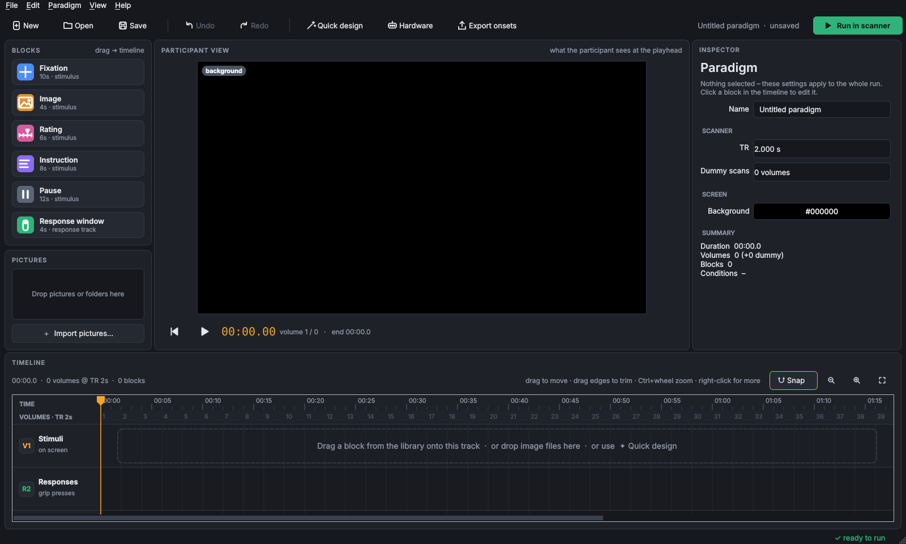
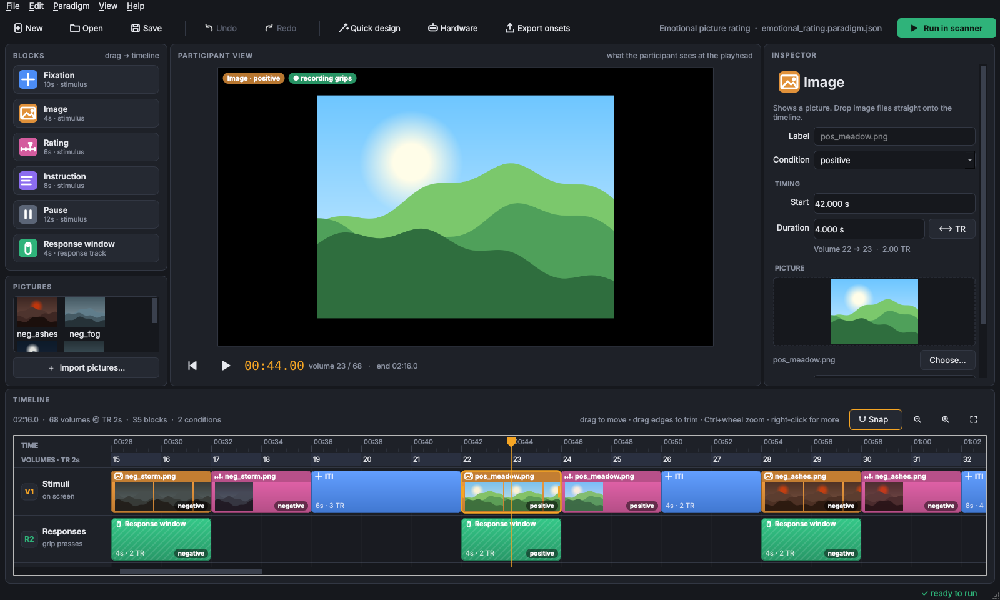
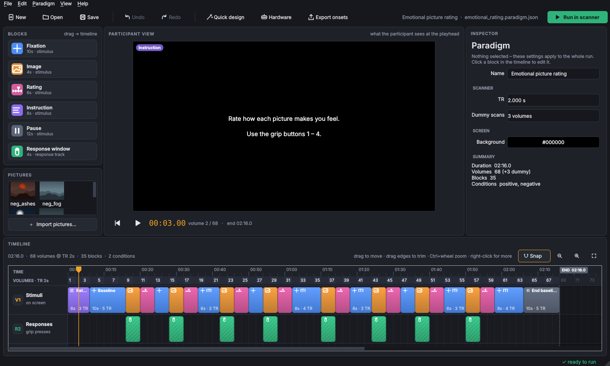
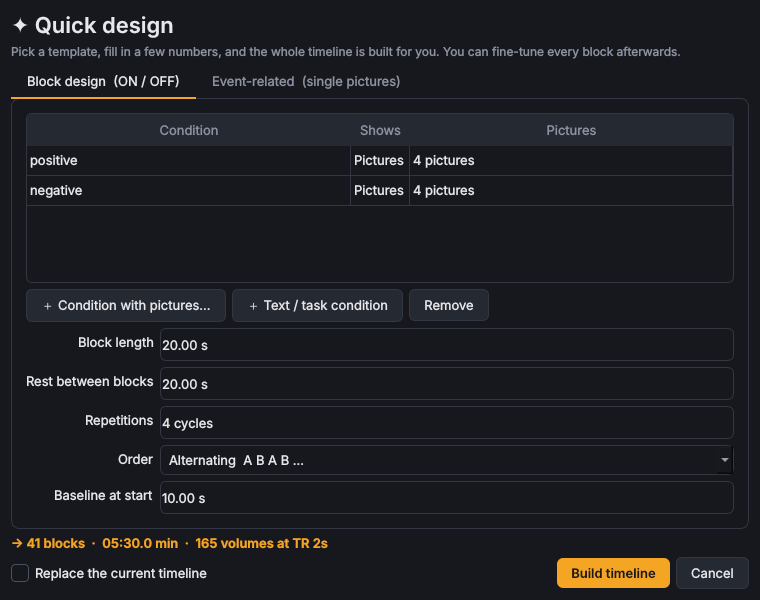
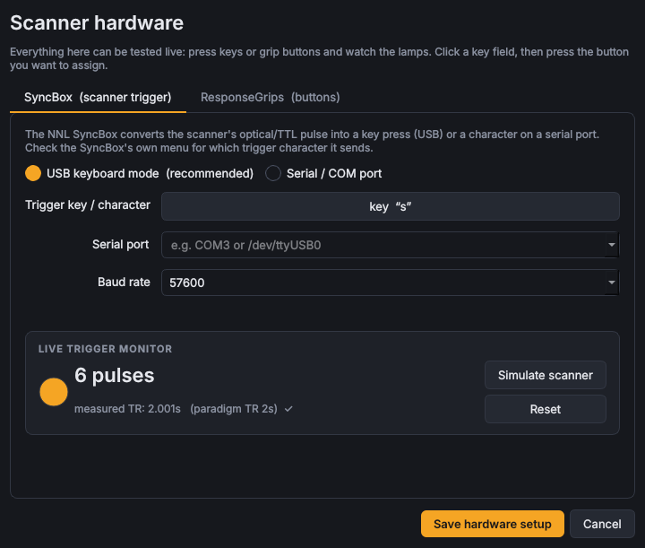
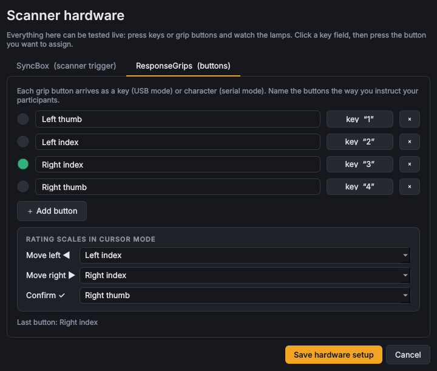
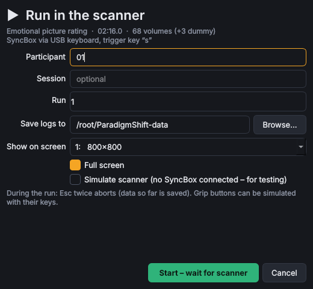
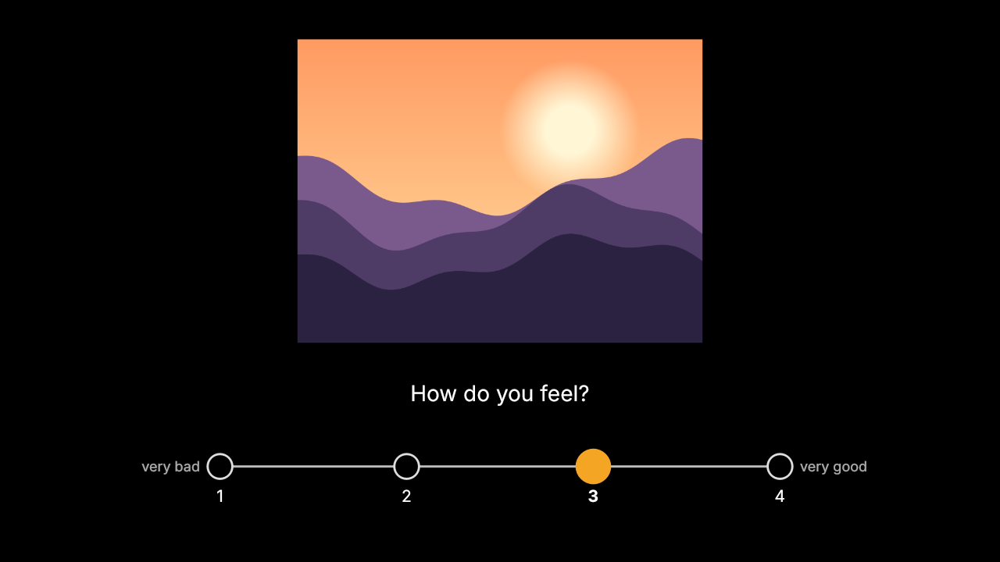

# ParadigmShift

A clean, film-editor style app for designing and running **fMRI paradigms** — written in Python with Qt (PySide6).

Build your run like a video edit: drag blocks onto a timeline, trim them to whole TRs, drop in pictures, preview
exactly what the participant will see, then press **Run in scanner**. The app waits for the
**NordicNeuroLab SyncBox** trigger and records **NNL ResponseGrip** presses and picture ratings into BIDS-style
`events.tsv` files.



## Start

```bash
pip install -r requirements.txt
python -m paradigmshift                                         # empty project
python -m paradigmshift examples/emotional_rating.paradigm.json # example
```

## How it works – at a glance

| Area | What you do there |
|---|---|
| **Blocks** (left) | Drag *Fixation, Image, Rating, Instruction, Pause, Response window* onto the timeline – or double-click to append. |
| **Pictures** (left) | Import pictures or drop folders; drag one or many onto the timeline (each becomes an image block). |
| **Participant view** (centre) | Shows the screen at the playhead. ▶ / Space plays a preview of the run. |
| **Inspector** (right) | Edit the selected block. With nothing selected: TR, dummy scans, background, run summary. |
| **Timeline** (bottom) | Ruler in time *and* volumes. Drag to move, drag edges to trim, everything snaps to the TR grid and to block edges (hold **Alt** to place freely). Track **V1** is what's on screen, **R2** records grip presses. |
| **✦ Quick design** | Builds a whole block design (ON/OFF, alternating or randomised) or an event-related design with jittered ITIs and optional ratings. |
| **Hardware** | Configure and *live-test* the SyncBox and grips (lamps light up, measured TR is shown, built-in scanner simulator). |
| **Run in scanner** | Participant ID, run, screen → full-screen presentation that waits for the trigger. |

Right-click anything on the timeline for more (duplicate, repeat ×N, split at playhead, close gaps…).
F1 lists the keyboard shortcuts.

## Scanner hardware (NNL)

* **SyncBox** – *USB keyboard mode* (default): the trigger arrives as a key, default `s`.
  *Serial mode*: choose the COM port / baud rate (needs `pyserial`). Set the trigger character to whatever your
  SyncBox is configured to send – click the field and send a pulse (or press the key) to learn it.
* **ResponseGrips** – four named buttons by default (`1`–`4`); rename, add, or re-learn keys in the Hardware dialog.
* **Rating scales** – *direct* (each grip button = one value) or *cursor* (move ◀ ▶, confirm ✓).
* **Simulate scanner** – test any paradigm on a laptop; triggers are generated at the TR.

## Output

For each run (in the chosen folder):

* `sub-01_task-<name>_run-01_events.tsv` – BIDS-style: `onset`, `duration`, `trial_type` (= condition),
  `stim_file`, `response`, `response_time`, `rating`, `correct`, and `planned_onset` for timing checks.
* `sub-01_task-<name>_run-01_log.tsv` – every trigger and button press with its time.

Onsets are relative to the first trigger after the dummy scans. **Export onsets** writes the planned design as
`events.tsv` plus FSL 3-column files per condition.

> Timing note: stimuli are switched by a 1 ms precision timer and onsets are logged when the switch happens;
> drawing is not locked to the display refresh. For publication-grade timing, verify with a photodiode.

Paradigms are saved as `*.paradigm.json` (picture paths stored relative to the file).

## Screenshots

| | |
|---|---|
|  First launch – the empty timeline tells you what to do |  Zoomed in: picture thumbnails, conditions, response windows |
|  Nothing selected → paradigm settings & summary |  Quick design wizard |
|  SyncBox setup with live trigger monitor |  ResponseGrips with live button lamps |
|  Run setup |  Participant screen: rating trial |

Screenshots are generated with `QT_QPA_PLATFORM=offscreen python tools/screenshots.py`.

## Development

```bash
pip install -e ".[test,serial]"
QT_QPA_PLATFORM=offscreen pytest
python tools/make_example.py     # regenerates examples/
```

Code layout: `model.py` (paradigm, blocks, generators – no Qt), `timeline.py`, `panels.py`, `dialogs.py`,
`runner.py` (presentation + logging), `hardware.py` (SyncBox/grips input), `stimulus.py` (shared renderer).
